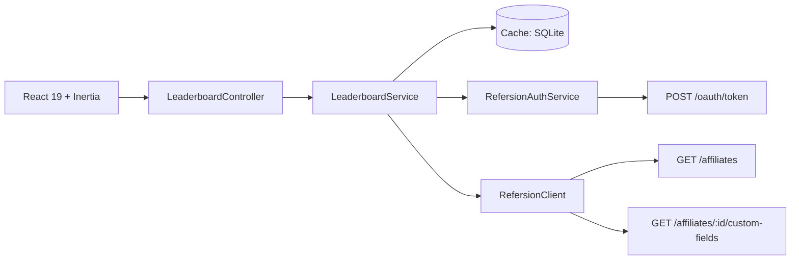

# Refersion Affiliate Leaderboard

A Dockerized Laravel + React example project that builds a leaderboard of the top five affiliates by lifetime commission using the Refersion API.

> **Project status:** The specification and architecture are complete. The Laravel/React application, Docker setup, and automated test suite are the next implementation milestone. The full design is in [`docs/superpowers/specs/2026-11-12-refersion-leaderboard-design.md`](docs/superpowers/specs/2026-11-12-refersion-leaderboard-design.md).

---

## Overview

The application connects to a Refersion account, retrieves every affiliate, inspects each affiliate's custom fields, and ranks the eligible affiliates by `performance.total.commission` from highest to lowest.

It is intentionally small in scope but production-minded in the areas that matter:

- OAuth2 client-credentials authentication with a reused, cached token.
- Full pagination of the affiliate list.
- Strict custom-field eligibility: label `Display in leaderboard`, value exactly `TRUE`.
- Concurrent custom-field requests with a controlled batch size and an early exit.
- Integer-cent ranking to avoid floating-point and lexicographic sorting errors.
- Explicit handling for `429`, `5xx`, `401`, and `404` responses.
- Cached leaderboard results with a manual refresh that respects rate limits.
- A polished React interface with loading, success, empty, error, and refreshing states.
- A single-command Docker environment for local development.

---

## Highlights

| Area | Behavior |
|---|---|
| Ranking | Top five eligible affiliates by lifetime commission, descending |
| Eligibility | Exact `Display in leaderboard` = `TRUE`; no trimming or case folding |
| Pagination | `page=1`, `limit=100`, continue until a page returns fewer than `limit` |
| Custom fields | Concurrent batches of 10, stop as soon as five eligible affiliates are found |
| Auth | OAuth2 `short_lived` token, cached for `expires_in - 60` seconds with a lock |
| Rate limits | `429` handled with `Retry-After`; `5xx` retried with backoff |
| Caching | Leaderboard result cached for 5 minutes; refresh forces a rebuild |
| UI | Responsive table, top-three rank badges, currency formatting, skeleton loading |
| Errors | Friendly error banner with a support reference; no raw API details exposed |
| Testing | Automated tests use `Http::fake()` and never call the real API |

---

## UI preview

```text
┌────────────────────────────────────────────────────────────────────┐
│  REFERSION                              Affiliate program         │
│                                                                    │
│  Top affiliates leaderboard                        [ Refresh data ] │
│  Ranked by lifetime total commission                               │
│  Only affiliates opted in with “Display in leaderboard”.           │
│                                                                    │
│  ┌──────────────────────────────────────────────────────────────┐  │
│  │ #   Affiliate              Email              Lifetime       │  │
│  │ 1   Lily Kertzmann         lily@example.com   $7,025.13      │  │
│  │ 2   Clark Rolfson          clark@example.com  $5,748.70      │  │
│  │ 3   Peter Bosco            peter@example.com  $5,726.66      │  │
│  │ 4   Chauncey Hartmann      chauncey@ex.com    $5,627.30      │  │
│  │ 5   Mitchel Ortiz          mitchel@example.com $4,772.34     │  │
│  └──────────────────────────────────────────────────────────────┘  │
│                                                                    │
│  ● Cached · Updated 2 min ago · Scanned 20 of 44 affiliates        │
└────────────────────────────────────────────────────────────────────┘
```

The final UI uses the Refersion-inspired palette: deep indigo, warm off-white, lime accents, and restrained gold/silver/bronze rank treatments.

---

## Architecture



### Responsibilities

| Layer | Responsibility |
|---|---|
| `LeaderboardController` | HTTP/Inertia boundary, request validation, error presentation |
| `LeaderboardService` | Pagination, sorting, eligibility, early exit, caching, DTO assembly |
| `RefersionAuthService` | OAuth exchange, token cache, lock, refresh-on-401 |
| `RefersionClient` | HTTP concerns: base URL, auth header, pagination, pooled requests, retries |
| `Money` | Centralized conversion from API values to integer minor units |
| DTOs | Immutable transport objects shared between layers |
| React page/components | Presentation only; no secrets or direct Refersion calls |

The controller stays thin. All Refersion calls live in the service/client layer, and the ranking logic is independently testable.

---

## How it works

### 1. Authentication

The app exchanges the Refersion client credentials for a Bearer token:

```http
POST https://auth.refersion.com/oauth/token
Content-Type: application/x-www-form-urlencoded

client_id=...
client_secret=...
token_type=short_lived
```

The token is cached under a key derived from the client ID and reused until `expires_in - 60` seconds. A cache lock prevents concurrent requests from issuing multiple tokens, because Refersion revokes the previous token of the same type when a new one is requested.

If an API call returns `401`, the cached token is invalidated and the request is retried once with a fresh token.

### 2. Fetching affiliates

```http
GET /affiliates?page=1&limit=100
Authorization: Bearer <token>
```

The client starts at `page=1` and continues while the response contains exactly `limit` records. It stops on a short page or an empty page. The full list is retained so the ranking can be calculated correctly.

### 3. Custom fields and eligibility

For each candidate, the app calls:

```http
GET /affiliates/{affiliateId}/custom-fields
Authorization: Bearer <token>
```

An affiliate is eligible only when the response contains a field with:

```text
label === "Display in leaderboard"
value === "TRUE"
```

No trimming, lowercasing, boolean casting, or coercion is applied. Values such as `true`, `TRUE ` (trailing space), `TRU`, and `FALSE` are not eligible.

### 4. Ranking and early exit

1. Fetch all affiliates.
2. Sort the complete list by commission descending, then affiliate ID ascending for deterministic ties.
3. Process candidates in batches of 10.
4. Fetch custom fields concurrently with `Http::pool()`.
5. For each candidate, in sorted order, check the exact eligibility rule.
6. Stop as soon as five eligible affiliates are found.

Sorting before the custom-field requests is what makes the early exit correct: the first five eligible affiliates encountered are also the true top five by commission.

### 5. Rate limits and retries

| Condition | Behavior |
|---|---|
| `429 Too Many Requests` | Read `Retry-After` (or `retryAfter` in the body), wait up to 30 seconds, retry up to twice |
| `5xx` / connection timeout | Retry up to twice with exponential backoff |
| `401` / `403` | Invalidate the token, request one new token, retry once |
| `404` on custom fields | Log a warning, treat the affiliate as ineligible, continue |
| Other `4xx` | Fail with a typed exception; do not retry |
| Invalid/malformed JSON | Fail with a typed exception; do not retry indefinitely |

The Refersion read allowance is 300 requests per minute per account. The early exit keeps the observed workload well below that: one list request plus two batches of ten custom-field requests for the sample account, instead of 45 requests for a naive implementation.

### 6. Caching and refresh

- The leaderboard result is cached for 5 minutes.
- The OAuth token is cached separately until shortly before expiry.
- A successful refresh replaces the cached result.
- A failed refresh leaves the previous cached result intact; the UI keeps showing the last successful data with a warning banner.
- The refresh endpoint is throttled at 10 requests per minute per IP.

---

## Example output

A sample Refersion account produces this leaderboard:

| Rank | Affiliate | Lifetime commission |
|---:|---|---:|
| 1 | Lily Kertzmann | $7,025.13 |
| 2 | Clark Rolfson | $5,748.70 |
| 3 | Peter Bosco | $5,726.66 |
| 4 | Chauncey Hartmann | $5,627.30 |
| 5 | Mitchel Ortiz | $4,772.34 |

The sample data also contains near-matches such as `true`, `TRUE ` (trailing space), `false`, and `no`. They are excluded by the strict eligibility rule.

---

## Tech stack

| Layer | Technology |
|---|---|
| Backend | Laravel 13, PHP 8.4 |
| Frontend | React 19, TypeScript, Inertia 2 |
| Styling | Tailwind CSS 4 |
| Build | Vite |
| Cache/locks | Laravel database cache backed by SQLite |
| Tests | Pest (or PHPUnit if the Laravel skeleton uses it) |
| Container | Docker multi-stage build, Nginx + PHP-FPM |
| CI | GitHub Actions |

---

## Getting started

> The first milestone in this repository is the design and documentation. The commands below describe the target developer experience for the application implementation.

### Prerequisites

- Docker and Docker Compose
- Refersion API credentials (Client ID and Client Secret)

### Setup

```bash
cp .env.example .env
# Add REFERSION_CLIENT_ID and REFERSION_CLIENT_SECRET to .env
docker compose up --build
```

Open [http://localhost:8080](http://localhost:8080).

### Useful commands

```bash
# Run the automated test suite
docker compose exec app php artisan test

# Check PHP formatting
docker compose exec app ./vendor/bin/pint --test

# Stop the stack
docker compose down

# Stop and remove the cache volume (forces fresh API data)
docker compose down -v
```

---

## Testing

The automated suite is designed around Laravel's HTTP fake and does not call the real Refersion API. Fixtures are synthetic and anonymized; no live affiliate PII or credentials are committed.

Planned coverage:

- Token exchange, reuse, expiry, and refresh-on-401.
- Multi-page affiliate pagination and the exact stopping condition.
- Strict custom-field eligibility, including near-match decoys.
- Descending commission ordering, ties, and the top-five cut.
- Early-exit request counts.
- `429`/`5xx` retries, `404` skipping, and typed failures.
- Cache hits, forced refresh, and failed-refresh resilience.
- Inertia page and refresh responses.
- Currency formatting and UI state rendering.

```bash
docker compose exec app php artisan test
docker compose exec app ./vendor/bin/pint --test
```

GitHub Actions runs the same checks on every push and pull request.

---

## Project structure

```text
app/
  DTOs/
  Exceptions/
  Http/Controllers/
  Http/Requests/
  Services/Leaderboard/
  Services/Refersion/
  Support/
config/
  services.php
resources/
  css/app.css
  js/Pages/Leaderboard.tsx
  js/Components/
  js/lib/
  js/types/
routes/
  web.php
tests/
  Unit/
  Feature/
docker/
  nginx.conf
  supervisord.conf
  entrypoint.sh
docs/
  superpowers/specs/
.github/workflows/
```

The complete file layout, contracts, and test matrix are in the design document.

---

## Design decisions and trade-offs

### Inertia + React instead of a separated SPA

**Chosen for this project.** Inertia keeps the backend and frontend in one Laravel application, which means one build, one deployment, no CORS configuration, and no internal API authentication. React still provides the SPA experience, and Inertia deferred props make the initial skeleton straightforward.

A separated Laravel JSON API + React SPA is the better choice when the frontend is owned by another team, consumed by mobile or third-party clients, or deployed independently. The service layer is deliberately independent so that split remains possible later.

### SQLite cache instead of Redis

**Chosen for this project.** The app is a stateless aggregator with no domain tables. SQLite backs Laravel's database cache and supports atomic locks, which is enough for a single-container deployment. Redis would add a second service and more failure modes without changing the product behavior at this scale.

For multiple application replicas, Redis becomes the correct choice: it shares the token and leaderboard cache across instances and supports distributed locks.

### Commission values as integer cents

The live API returns integer values that sum exactly from conversion records and are realistic only as minor units. The app therefore stores and ranks integer cents, then formats them as USD in React. The conversion is centralized in a `Money` value object and can be switched with `REFERSION_COMMISSION_UNIT=major` if an account returns major units.

### Synchronous refresh

The first implementation builds the leaderboard during the request, with a short cache TTL and a spinner in the UI. This keeps the project easy to run and reason about. For large accounts with sparse eligibility, the synchronous path is bounded by `REFERSION_MAX_CANDIDATES` and returns an explicit error rather than an incomplete leaderboard. The next step is a queued job with progress reporting, shared pacing, and a scheduled refresh.

### Friendly error state over a raw 5xx page

Upstream failures are rendered as a structured Inertia error state with a support reference. The page keeps the last successful result visible when possible. A public JSON API would return an appropriate `503`; for this Inertia UI, a rendered error state is more useful and still logs the technical details server-side.

---

## Design language

The interface draws from the Refersion brand palette extracted from the public site.

| Token | Hex | Use |
|---|---|---|
| Deep indigo | `#221F4E` | Header, headings, primary actions |
| Electric blue | `#3A86FF` | Links, focus rings, accents |
| Lime | `#54DE62` | Success, highlights, accent line |
| Cream | `#FFF5E2` | Warm surfaces, hover states |
| Orange | `#FF6B35` | Secondary accent |
| Page canvas | `#F2F6EF` | Light greenish-grey background |
| Blue surface | `#D4E2F2` | Soft informational surfaces |
| Warm surface | `#DED7D4` | Borders and warm neutral surfaces |
| White | `#FFFFFF` | Cards and table surfaces |
| Brand body | `#5F738C` | Body text on white |

Accessible application variants are defined in the design document, including a darker muted text color for the light canvas and a darker link blue for normal-size text.

**Typography:** Manrope for display/headings and Inter for body, bundled locally. The Refersion site uses the licensed Catalogue and Cera Pro families; Manrope is a close open-source stand-in.

---

## Security

- API credentials live in `.env` and are never committed.
- OAuth tokens and client secrets are never sent to React or written to logs.
- Upstream error details are sanitized; the UI receives a generic message and a short reference.
- The refresh endpoint is throttled, and the public route is documented as needing authentication/SSO in production.
- React escapes API-provided text by default; no `dangerouslySetInnerHTML` is used for affiliate data.
- Nginx adds standard security headers.
- The automated tests use fake HTTP responses and require no real credentials.

---

## AI-assisted development

AI tools were used to analyze the Refersion API, validate the integration strategy, inspect the public brand styles, and draft the specification. The implementation is expected to be reviewed, tested, and adjusted by the maintainers rather than accepted blindly.

See [`AI_USAGE.md`](AI_USAGE.md) for the tools, prompts, tasks, and verification notes.

---

## Roadmap

- [ ] Scaffold Laravel + React/Inertia and Tailwind.
- [ ] Implement the Refersion auth, client, and leaderboard services.
- [ ] Add the Docker multi-stage build and Compose stack.
- [ ] Build the leaderboard UI and all UI states.
- [ ] Add the Pest test suite and GitHub Actions workflow.
- [ ] Verify the Docker flow and the sample-account output end to end.
- [ ] Update this README with a screenshot and final setup notes.
- [ ] Move cache/locks to Redis and add a queued refresh for larger deployments.
- [ ] Add webhook-driven cache invalidation.
- [ ] Add production authentication/SSO and observability.

---

## Notes

Refersion is a trademark of Refersion, Inc. This is an independent example project and is not affiliated with Refersion.
